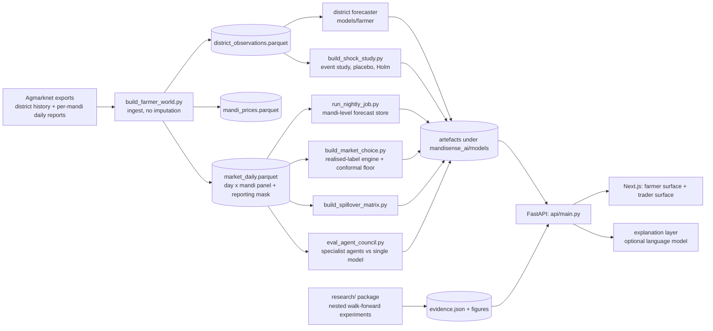
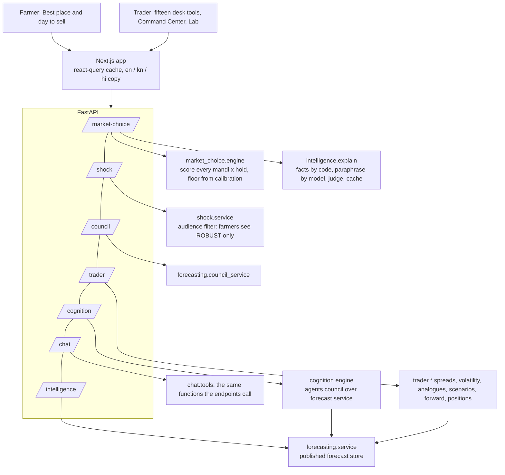

# Architecture

MandiSense is a batch-trained, read-mostly system: models and statistical studies are built offline and written to artefacts; the
API reads those artefacts and does small amounts of arithmetic per request. Nothing the user sees is computed from data the offline
tests did not cover, and every response carries the evidence that decides how far to trust it.

## Data flow

`scripts/pipeline.py` runs these stages in dependency order, checks each stage's inputs exist, times it and writes
`logs/pipeline_report.json`.

## Runtime view

## How the main answers are produced

**Where and when to sell** (`market_choice/`). For one origin, every nearby mandi and each hold of 0–3 days (plus the farm gate) is
scored by predicted *realised* net revenue per quintal: price at that mandi, minus transport, fee and spoilage, with a silent mandi
priced at a discounted fallback because the model was trained on what farmers actually received. A conformal calibration, adapted
online with delayed feedback, converts each score into a **floor**; the recommendation maximises expected revenue, and the
"safest" alternative maximises the floor. The backtest (three segments, a held-out evaluation window, violation rates, gain over
simple rules) is stored with the model and shown beside the advice; a crop whose backtest does not clear its checks is refused rather
than advised on.

**Why this advice** (`intelligence/explain.py`). Code writes the reasons as sentences with slots and fills every number, mandi name
and date itself. A language model may only paraphrase each sentence; the paraphrase must keep exactly the same slots, add no digit
or overclaiming word and stay in the requested script, and a second model from a different family must judge that it still means
the same thing. Any sentence that fails keeps its code-written wording, and the response says who wrote it.

**What supply shocks mean** (`shock/`). The radar reports each district's arrivals against its trailing norm and the price gap to
its neighbours. A price-response claim is attached only if the offline study rated it ROBUST; farmers receive nothing weaker, and the
study found no robust response (see `docs/SHOCK_STUDY.md`).

**The agent council** (`forecasting/council.py`). Four specialists (seasonality, supply, market activity, price trend) each see one
family of the forecaster's features; weights are learned inside each walk-forward fold, are non-negative and sum to at most one.
It is scored on the same rows as the single served model and promoted only if significantly better; it currently is not
(`docs/AGENT_COUNCIL.md`). External factors (weather, news) are shown as live context with no forecast weight.

**Trader surfaces on cognition** (`cognition/`). Per-series states are generated at start-up from the validated forecasts, one per
(commodity, mandi) with a forecast, and pruned if a snapshot recorded a collapse or belongs to a series that no longer exists.
Implausible forecasts (a move larger than the model was validated on, usually a reporting quirk in the latest price) are given
almost no weight and say so.

## Design rules that run through the code

1. **No imputation.** A mandi that did not report has no row; models are told about the absence, not given an invented price.
2. **Causal features only.** Every feature uses information available on the decision day; a guard fails training if a target column leaks.
3. **Evidence travels with the answer.** Backtests, intervals, evidence tiers and the author of any text are part of the response, not a separate report.
4. **Refuse rather than guess.** Unvalidated crops, short histories and unmeasured quantities return an explicit `UNAVAILABLE` with a reason.
5. **Models never decide meaning or numbers.** A language model can change wording; code owns facts, and an independent check guards the meaning.
6. **One identity per mandi.** `forecasting.naming.world_market` / `forecast_market` map the historical spellings of the Bengaluru market to one series.

## Where to look

| To change… | Start in |
|---|---|
| How the advice is scored | `mandisense_ai/market_choice/engine.py`, `econ.py`, `conformal.py` |
| What the farmer is told and in which words | `mandisense_ai/intelligence/explain.py`, `frontend/src/lib/i18n/*Copy.ts` |
| Shock definitions and tiers | `mandisense_ai/shock/study.py`, `shock/service.py` |
| The served forecaster | `mandisense_ai/forecasting/train.py`, `features.py`, `config.py` |
| A new trader tool | `frontend/src/lib/traderTools.ts`, a page under `frontend/src/app/trader-tools/` (a registry test checks they agree) |
| The paper's experiments | `research/gfmc/`, `research/scripts/`, `research/docs/` |
