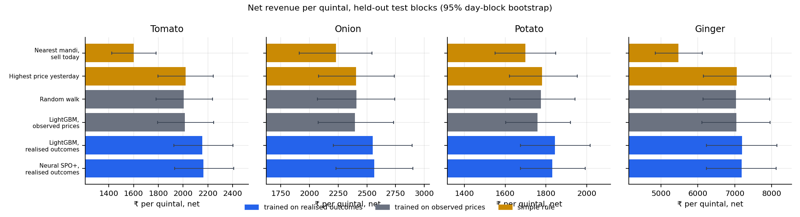
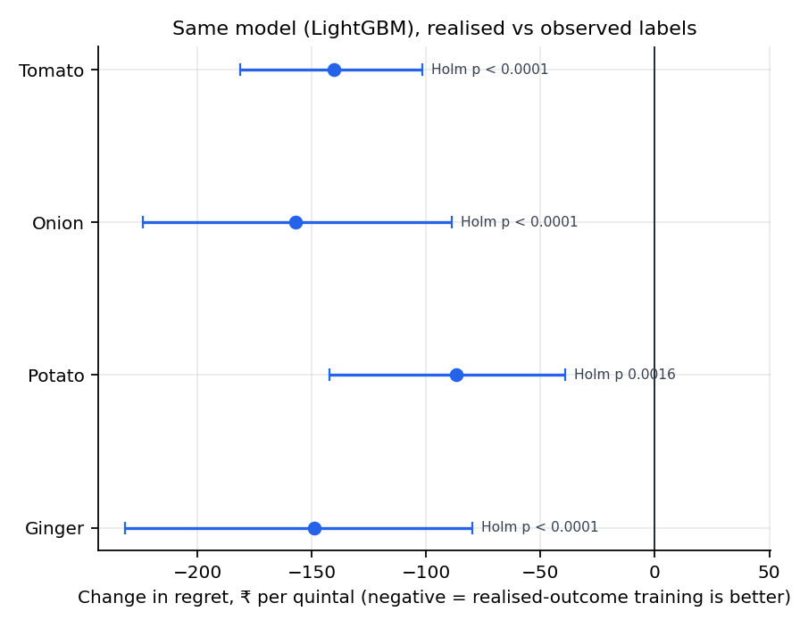
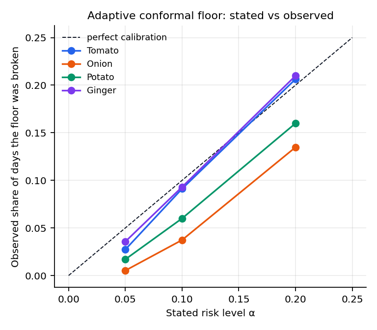
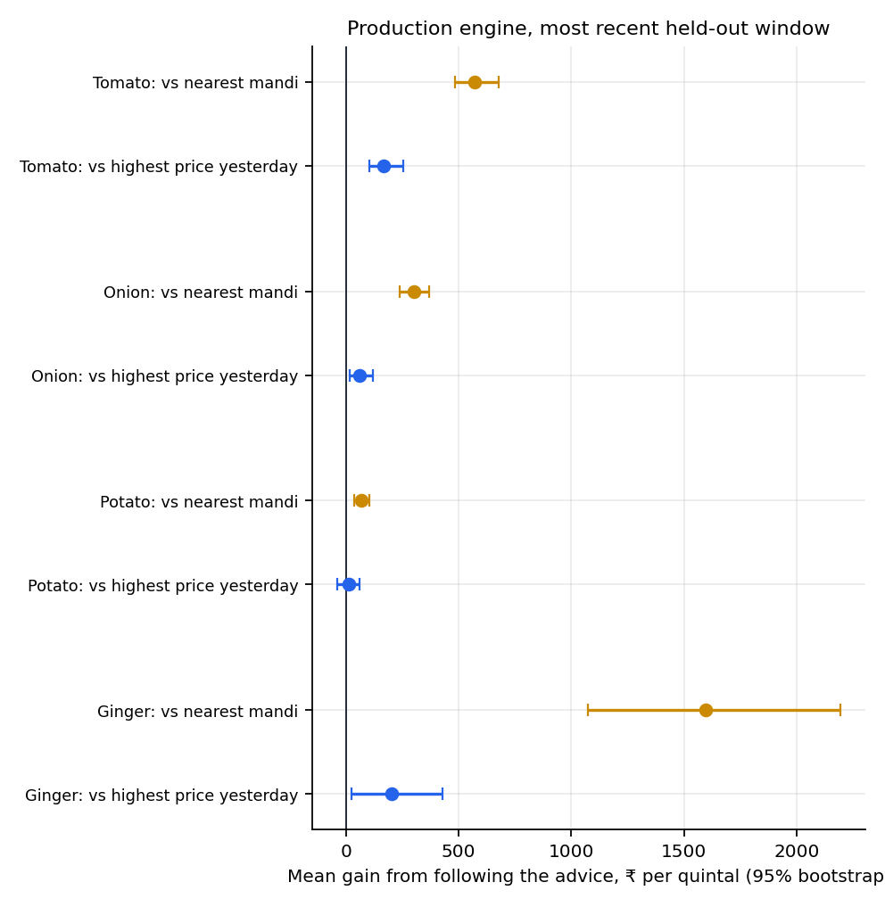
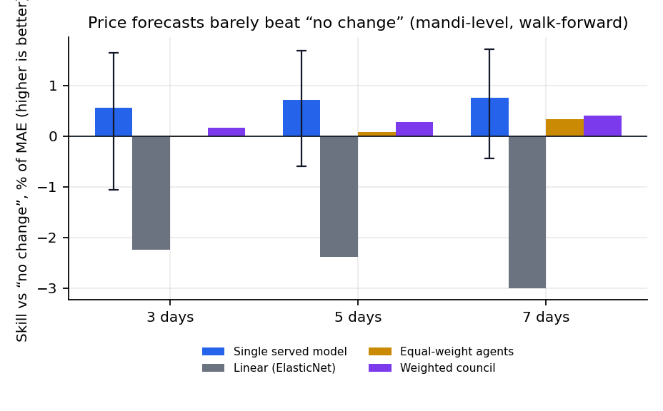
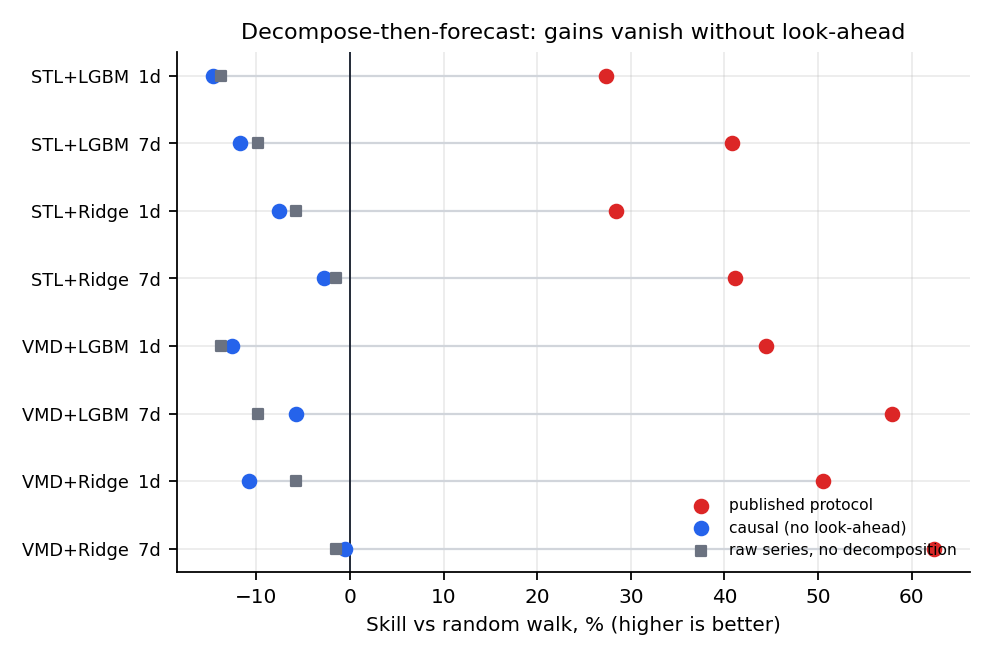
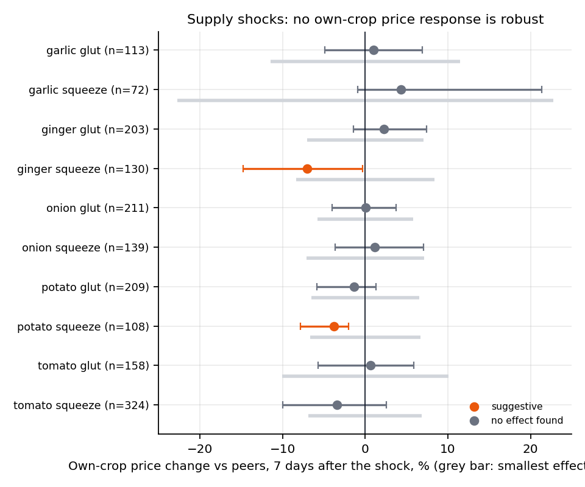

# Results, validation and benchmarking

Generated 2026-10-29 14:45Z by `scripts/build_results.py` from the artefacts listed in §11. Every number below is read from them. All figures are on **held-out** data: nested walk-forward blocks the models never trained or tuned on (§1).

## Summary

| Question | Result |
|---|---|
| Does training on what a farmer actually received beat training on observed prices? | Change in regret, ₹ per quintal, same LightGBM: tomato -140 (Holm p < 0.0001); onion -157 (Holm p < 0.0001); potato -87 (Holm p 0.0016); ginger -149 (Holm p < 0.0001). Negative is better. |
| Does the production advice beat simple rules out of sample? | In 4 of 5 crops the engine has a validated backtest; tomato +170 ₹/q vs highest-price-yesterday [+104, +255]; onion +60 ₹/q vs highest-price-yesterday [+16, +119]; potato +15 ₹/q vs highest-price-yesterday [-38, +60]; ginger +202 ₹/q vs highest-price-yesterday [+25, +429]. Garlic is refused (§4). |
| Are price forecasts accurate? | Barely better than “no change”: 5-day skill +0.7% on mandi-level series; the interval against no change is [-0.00269, +0.00095] in log-return MAE. |
| Do published decompose-then-forecast hybrids hold up? | No: +27 to +62% skill under the published protocol, -15 to -1% without look-ahead. |
| Do arrival gluts or squeezes move prices? | No robust effect: 30 tests, 0 robust, 5 suggestive. |

## 1. Evaluation protocol

**Data.** Agmarknet market-level history, 2021-01-01 to 2026-10-26, 63,524 rows after cleaning (63,526 read; 0 non-positive prices and 0 duplicates handled). No price is imputed: a mandi that did not report on a day has no row.

**Held-out test blocks.** Five outer walk-forward blocks; for each, models are tuned on inner validation blocks that precede it (with a gap of the longest horizon plus two days), fitted on everything before, and scored only on the block.

| Outer block | Test window |
|---|---|
| 0 | 2024-01-01..2024-07-01 |
| 1 | 2024-07-01..2025-01-01 |
| 2 | 2025-01-01..2025-07-01 |
| 3 | 2025-07-01..2026-01-01 |
| 4 | 2026-01-01..2026-10-28 |

| Crop | Test days | Methods compared |
|---|---|---|
| Tomato | 963 | 16 |
| Onion | 511 | 10 |
| Potato | 569 | 10 |
| Ginger | 776 | 10 |

**Metrics.**
- *Decision quality:* realised net revenue per quintal after transport, fees and spoilage (₹), regret against a hindsight oracle, share of the oracle gap closed relative to the nearest mandi, CVaR at 10% (the mean of the worst 10% of days), and the fallback-trip rate (days the chosen mandi turned out silent).
- *Floor validity:* the share of days realised revenue fell below the stated floor, against the stated risk level α.
- *Forecast quality:* mean absolute error of the h-day log-return, reported as skill (the reduction against a forecast of no change), direction accuracy and 90% interval coverage.

**Baselines.** Simple rules (nearest mandi, highest price yesterday, best 7-day mean, farm gate); a random walk made cost-aware; models trained on *observed* prices (LightGBM, XGBoost, neural) predict-then-optimise; models on *realised* outcomes (LightGBM, neural, SPO+ and variants); an ElasticNet linear model; equal-weight and learned-weight specialist ensembles; and the Chronos-Bolt zero-shot foundation model.

**Statistics.** Paired differences in daily regret with a day-block bootstrap (95% intervals), Diebold–Mariano tests with the Harvey–Leybourne–Newbold correction on date-averaged losses, Holm correction across each crop's family of comparisons, the Model Confidence Set at α = 0.10, week-block bootstrap for forecasts, and circular-shift placebos for event studies. Costs (transport ₹0.70 per quintal-km, 4% fee, crop spoilage, 0.85 silent-mandi factor) are scenario assumptions, varied in §8.

## 2. Decision quality, five nested test blocks



### Tomato (hindsight oracle ₹2,570/q)

| Method | Net revenue ₹/q [95% CI] | Oracle gap closed | CVaR₁₀ | Fallback trips |
|---|---|---|---|---|
| Nearest mandi, sell today | 1,600 [1,423, 1,781] | 0.00 | 605 | 33.7% |
| Highest price yesterday | 2,021 [1,796, 2,244] | 0.43 | 690 | 27.8% |
| Best 7-day mean | 1,993 [1,776, 2,228] | 0.41 | 669 | 28.3% |
| Random walk | 2,006 [1,782, 2,237] | 0.42 | 675 | 29.7% |
| LightGBM, observed prices | 2,016 [1,793, 2,246] | 0.43 | 679 | 28.7% |
| XGBoost, observed prices | 2,019 [1,799, 2,246] | 0.43 | 674 | 29.3% |
| Neural, observed prices | 2,016 [1,791, 2,252] | 0.43 | 681 | 29.4% |
| LightGBM, realised outcomes | 2,156 [1,927, 2,402] | 0.57 | 791 | 12.4% |
| LightGBM, realised + silence | 2,168 [1,932, 2,416] | 0.59 | 801 | 11.6% |
| Neural, realised outcomes | 2,139 [1,909, 2,384] | 0.56 | 818 | 11.3% |
| Neural SPO+, realised outcomes | 2,164 [1,932, 2,408] | 0.58 | 802 | 12.5% |
| SPO+ + reporting head | 2,141 [1,916, 2,383] | 0.56 | 820 | 11.9% |
| SPO+ + head + silence | 2,148 [1,926, 2,374] | 0.56 | 828 | 10.6% |

Model Confidence Set (α = 0.10): LightGBM, realised outcomes, LightGBM, realised + silence, Neural, realised outcomes, Neural SPO+, realised outcomes, SPO+ + reporting head, SPO+ + head + silence, gfmc_pred_tuneMSE. Every method outside it, including every rule, is statistically excluded.

Paired comparisons (negative: the first method has lower regret):

| Comparison | Δ regret ₹/q | 95% CI | Holm p | Wins |
|---|---|---|---|---|
| GFMC predictor vs random walk | -141 | [-185, -98] | < 0.0001 | 36% |
| GFMC predictor vs LightGBM (predict-then-optimise) | -132 | [-174, -90] | < 0.0001 | 32% |
| GFMC predictor vs XGBoost (predict-then-optimise) | -129 | [-171, -89] | < 0.0001 | 33% |
| GFMC predictor vs LightGBM on realised-revenue labels | +8 | [-18, +38] | 1.000 | 21% |
| GFMC predictor vs best simple heuristic | -127 | [-170, -87] | < 0.0001 | 31% |
| [label effect] realised-revenue labels vs observed-price labels | -123 | [-165, -87] | < 0.0001 | 34% |
| [label effect, GBM] realised-revenue labels vs observed-price labels | -140 | [-181, -102] | < 0.0001 | 29% |
| SPO+ network on realised labels vs LightGBM predict-then-optimise | -149 | [-191, -109] | < 0.0001 | 32% |
| [loss effect] SPO+ vs MSE, same labels and network | -25 | [-53, +3] | 0.505 | 22% |
| [head effect] reporting head vs none | +23 | [+8, +36] | 0.012 | 13% |
| [silence effect] + network silence features | -6 | [-27, +20] | 1.000 | 19% |
| [silence effect] GBM with vs without silence features | -12 | [-31, +3] | 0.695 | 12% |
| [tuning effect] tuned on decision regret vs forecast loss | -8 | [-32, +15] | 1.000 | 20% |
| structured SPO+ network vs GBM, both on realised labels | +14 | [-8, +39] | 0.865 | 18% |

### Onion (hindsight oracle ₹2,902/q)

| Method | Net revenue ₹/q [95% CI] | Oracle gap closed | CVaR₁₀ | Fallback trips |
|---|---|---|---|---|
| Nearest mandi, sell today | 2,231 [1,911, 2,543] | 0.00 | 932 | 33.6% |
| Highest price yesterday | 2,407 [2,079, 2,738] | 0.26 | 1,097 | 42.9% |
| Best 7-day mean | 2,405 [2,062, 2,735] | 0.26 | 1,087 | 41.5% |
| Random walk | 2,407 [2,068, 2,741] | 0.26 | 1,099 | 43.2% |
| LightGBM, observed prices | 2,395 [2,076, 2,731] | 0.24 | 1,082 | 42.5% |
| LightGBM, realised outcomes | 2,552 [2,207, 2,893] | 0.48 | 1,212 | 18.4% |
| Neural, realised outcomes | 2,541 [2,201, 2,874] | 0.46 | 1,168 | 19.9% |
| Neural SPO+, realised outcomes | 2,564 [2,231, 2,900] | 0.50 | 1,201 | 19.6% |

Model Confidence Set (α = 0.10): LightGBM, realised outcomes, Neural, realised outcomes, Neural SPO+, realised outcomes. Every method outside it, including every rule, is statistically excluded.

Paired comparisons (negative: the first method has lower regret):

| Comparison | Δ regret ₹/q | 95% CI | Holm p | Wins |
|---|---|---|---|---|
| [label effect, GBM] realised-revenue labels vs observed-price labels | -157 | [-224, -89] | < 0.0001 | 43% |
| SPO+ network on realised labels vs LightGBM predict-then-optimise | -169 | [-234, -108] | < 0.0001 | 41% |
| [loss effect] SPO+ vs MSE, same labels and network | -23 | [-62, +11] | 0.212 | 27% |

### Potato (hindsight oracle ₹2,173/q)

| Method | Net revenue ₹/q [95% CI] | Oracle gap closed | CVaR₁₀ | Fallback trips |
|---|---|---|---|---|
| Nearest mandi, sell today | 1,699 [1,550, 1,848] | 0.00 | 842 | 34.2% |
| Highest price yesterday | 1,780 [1,620, 1,954] | 0.17 | 904 | 34.8% |
| Best 7-day mean | 1,780 [1,624, 1,950] | 0.17 | 894 | 35.1% |
| Random walk | 1,776 [1,623, 1,943] | 0.16 | 902 | 35.2% |
| LightGBM, observed prices | 1,758 [1,602, 1,919] | 0.12 | 881 | 34.0% |
| LightGBM, realised outcomes | 1,845 [1,674, 2,016] | 0.31 | 1,014 | 21.2% |
| Neural, realised outcomes | 1,831 [1,665, 2,007] | 0.28 | 1,037 | 17.6% |
| Neural SPO+, realised outcomes | 1,830 [1,675, 1,993] | 0.28 | 1,064 | 16.6% |

Model Confidence Set (α = 0.10): LightGBM, realised outcomes, Neural, realised outcomes, Neural SPO+, realised outcomes. Every method outside it, including every rule, is statistically excluded.

Paired comparisons (negative: the first method has lower regret):

| Comparison | Δ regret ₹/q | 95% CI | Holm p | Wins |
|---|---|---|---|---|
| [label effect, GBM] realised-revenue labels vs observed-price labels | -87 | [-142, -39] | 0.0016 | 47% |
| SPO+ network on realised labels vs LightGBM predict-then-optimise | -72 | [-109, -39] | 0.0002 | 54% |
| [loss effect] SPO+ vs MSE, same labels and network | +1 | [-27, +32] | 0.952 | 38% |

### Ginger (hindsight oracle ₹7,741/q)

| Method | Net revenue ₹/q [95% CI] | Oracle gap closed | CVaR₁₀ | Fallback trips |
|---|---|---|---|---|
| Nearest mandi, sell today | 5,476 [4,850, 6,122] | 0.00 | 2,272 | 23.5% |
| Highest price yesterday | 7,050 [6,155, 7,969] | 0.69 | 2,949 | 11.3% |
| Best 7-day mean | 7,034 [6,103, 7,908] | 0.69 | 2,967 | 11.1% |
| Random walk | 7,037 [6,140, 7,951] | 0.69 | 2,927 | 12.3% |
| LightGBM, observed prices | 7,047 [6,106, 7,961] | 0.69 | 2,902 | 12.2% |
| LightGBM, realised outcomes | 7,196 [6,238, 8,141] | 0.76 | 2,999 | 5.4% |
| Neural, realised outcomes | 7,122 [6,218, 8,031] | 0.73 | 3,039 | 7.1% |
| Neural SPO+, realised outcomes | 7,188 [6,233, 8,120] | 0.76 | 3,039 | 5.2% |

Model Confidence Set (α = 0.10): LightGBM, realised outcomes, Neural, realised outcomes, Neural SPO+, realised outcomes. Every method outside it, including every rule, is statistically excluded.

Paired comparisons (negative: the first method has lower regret):

| Comparison | Δ regret ₹/q | 95% CI | Holm p | Wins |
|---|---|---|---|---|
| [label effect, GBM] realised-revenue labels vs observed-price labels | -149 | [-232, -80] | < 0.0001 | 15% |
| SPO+ network on realised labels vs LightGBM predict-then-optimise | -141 | [-247, -58] | 0.0031 | 17% |
| [loss effect] SPO+ vs MSE, same labels and network | -66 | [-180, +30] | 0.165 | 18% |



## 3. The revenue floor

The floor is the lower bound the advice reports; its stated risk level is α, so a valid floor is broken on about α of days.



**Tomato**

| Predictor | Floor rule | Stated α | Observed violation | Mean floor ₹/q | Revenue ₹/q |
|---|---|---|---|---|---|
| SPO+ + head + silence | adaptive conformal floor | 0.05 | 4.6% | 1,167 | 2,077 |
| SPO+ + head + silence | adaptive conformal floor | 0.1 | 10.6% | 1,556 | 2,135 |
| SPO+ + head + silence | adaptive conformal floor | 0.2 | 23.3% | 1,853 | 2,149 |
| SPO+ + head + silence | static conformal floor | 0.1 | 9.0% | 1,470 | 2,125 |
| SPO+ + head + silence | naive Gaussian floor (z=1.28) | 0.1 | 3.3% | 1,096 | 2,042 |
| SPO+ + reporting head | adaptive conformal floor | 0.05 | 4.2% | 1,174 | 2,044 |
| SPO+ + reporting head | adaptive conformal floor | 0.1 | 10.6% | 1,541 | 2,116 |
| SPO+ + reporting head | adaptive conformal floor | 0.2 | 21.2% | 1,821 | 2,139 |
| SPO+ + reporting head | static conformal floor | 0.1 | 7.8% | 1,447 | 2,098 |
| SPO+ + reporting head | naive Gaussian floor (z=1.28) | 0.1 | 3.9% | 1,132 | 2,029 |
| LightGBM, realised outcomes | adaptive conformal floor | 0.05 | 3.0% | 841 | 1,857 |
| LightGBM, realised outcomes | adaptive conformal floor | 0.1 | 9.0% | 1,357 | 2,004 |
| LightGBM, realised outcomes | adaptive conformal floor | 0.2 | 21.3% | 1,809 | 2,129 |
| LightGBM, realised outcomes | static conformal floor | 0.1 | 6.0% | 1,216 | 1,968 |
| LightGBM, realised outcomes | naive Gaussian floor (z=1.28) | 0.1 | 17.3% | 1,710 | 2,129 |
| LightGBM, observed prices | adaptive conformal floor | 0.05 | 1.1% | -2,564 | 1,519 |
| LightGBM, observed prices | adaptive conformal floor | 0.1 | 7.8% | 1,151 | 1,858 |
| LightGBM, observed prices | adaptive conformal floor | 0.2 | 18.5% | 1,536 | 1,945 |
| LightGBM, observed prices | static conformal floor | 0.1 | 5.1% | 985 | 1,816 |
| LightGBM, observed prices | naive Gaussian floor (z=1.28) | 0.1 | 27.4% | 1,725 | 1,989 |
| Random walk | adaptive conformal floor | 0.05 | 0.7% | -30,841 | 1,508 |
| Random walk | adaptive conformal floor | 0.1 | 7.6% | 989 | 1,794 |
| Random walk | adaptive conformal floor | 0.2 | 18.8% | 1,462 | 1,903 |
| Random walk | static conformal floor | 0.1 | 4.8% | 868 | 1,750 |
| Random walk | naive Gaussian floor (z=1.28) | 0.1 | 31.0% | 1,791 | 1,960 |

**Onion**

| Predictor | Floor rule | Stated α | Observed violation | Mean floor ₹/q | Revenue ₹/q |
|---|---|---|---|---|---|
| LightGBM, realised outcomes | adaptive conformal floor | 0.05 | 1.6% | 709 | 2,295 |
| LightGBM, realised outcomes | adaptive conformal floor | 0.1 | 6.3% | 1,529 | 2,447 |
| LightGBM, realised outcomes | adaptive conformal floor | 0.2 | 15.5% | 2,053 | 2,522 |
| LightGBM, realised outcomes | static conformal floor | 0.1 | 4.0% | 1,630 | 2,475 |
| LightGBM, realised outcomes | naive Gaussian floor (z=1.28) | 0.1 | 18.6% | 2,082 | 2,526 |
| LightGBM, observed prices | adaptive conformal floor | 0.05 | 0.0% | -628 | 2,028 |
| LightGBM, observed prices | adaptive conformal floor | 0.1 | 2.7% | 558 | 2,175 |
| LightGBM, observed prices | adaptive conformal floor | 0.2 | 12.7% | 1,655 | 2,292 |
| LightGBM, observed prices | static conformal floor | 0.1 | 2.6% | 1,200 | 2,200 |
| LightGBM, observed prices | naive Gaussian floor (z=1.28) | 0.1 | 34.5% | 2,223 | 2,375 |
| Random walk | adaptive conformal floor | 0.05 | 0.0% | -72,574 | 2,004 |
| Random walk | adaptive conformal floor | 0.1 | 2.2% | -26,246 | 2,159 |
| Random walk | adaptive conformal floor | 0.2 | 12.3% | 744 | 2,297 |
| Random walk | static conformal floor | 0.1 | 3.3% | 1,053 | 2,201 |
| Random walk | naive Gaussian floor (z=1.28) | 0.1 | 36.8% | 2,272 | 2,376 |

**Potato**

| Predictor | Floor rule | Stated α | Observed violation | Mean floor ₹/q | Revenue ₹/q |
|---|---|---|---|---|---|
| LightGBM, realised outcomes | adaptive conformal floor | 0.05 | 2.5% | 591 | 1,752 |
| LightGBM, realised outcomes | adaptive conformal floor | 0.1 | 6.9% | 1,242 | 1,826 |
| LightGBM, realised outcomes | adaptive conformal floor | 0.2 | 17.7% | 1,595 | 1,834 |
| LightGBM, realised outcomes | static conformal floor | 0.1 | 6.2% | 1,217 | 1,826 |
| LightGBM, realised outcomes | naive Gaussian floor (z=1.28) | 0.1 | 14.2% | 1,564 | 1,839 |
| LightGBM, observed prices | adaptive conformal floor | 0.05 | 1.4% | 206 | 1,646 |
| LightGBM, observed prices | adaptive conformal floor | 0.1 | 6.5% | 983 | 1,705 |
| LightGBM, observed prices | adaptive conformal floor | 0.2 | 15.4% | 1,457 | 1,764 |
| LightGBM, observed prices | static conformal floor | 0.1 | 5.1% | 983 | 1,724 |
| LightGBM, observed prices | naive Gaussian floor (z=1.28) | 0.1 | 25.8% | 1,642 | 1,755 |
| Random walk | adaptive conformal floor | 0.05 | 1.2% | -3,926 | 1,606 |
| Random walk | adaptive conformal floor | 0.1 | 4.6% | -251 | 1,705 |
| Random walk | adaptive conformal floor | 0.2 | 14.9% | 1,419 | 1,781 |
| Random walk | static conformal floor | 0.1 | 4.6% | 886 | 1,712 |
| Random walk | naive Gaussian floor (z=1.28) | 0.1 | 22.5% | 1,648 | 1,790 |

**Ginger**

| Predictor | Floor rule | Stated α | Observed violation | Mean floor ₹/q | Revenue ₹/q |
|---|---|---|---|---|---|
| LightGBM, realised outcomes | adaptive conformal floor | 0.05 | 4.3% | 5,067 | 6,787 |
| LightGBM, realised outcomes | adaptive conformal floor | 0.1 | 10.5% | 5,986 | 7,003 |
| LightGBM, realised outcomes | adaptive conformal floor | 0.2 | 20.4% | 6,739 | 7,179 |
| LightGBM, realised outcomes | static conformal floor | 0.1 | 8.9% | 5,984 | 7,025 |
| LightGBM, realised outcomes | naive Gaussian floor (z=1.28) | 0.1 | 9.3% | 6,095 | 7,045 |
| LightGBM, observed prices | adaptive conformal floor | 0.05 | 3.4% | 2,631 | 6,670 |
| LightGBM, observed prices | adaptive conformal floor | 0.1 | 8.6% | 5,890 | 6,889 |
| LightGBM, observed prices | adaptive conformal floor | 0.2 | 20.9% | 6,710 | 7,018 |
| LightGBM, observed prices | static conformal floor | 0.1 | 6.7% | 5,810 | 6,916 |
| LightGBM, observed prices | naive Gaussian floor (z=1.28) | 0.1 | 11.9% | 6,203 | 6,949 |
| Random walk | adaptive conformal floor | 0.05 | 3.1% | -12,528 | 6,548 |
| Random walk | adaptive conformal floor | 0.1 | 8.8% | 5,582 | 6,767 |
| Random walk | adaptive conformal floor | 0.2 | 21.6% | 6,587 | 7,004 |
| Random walk | static conformal floor | 0.1 | 7.9% | 5,764 | 6,896 |
| Random walk | naive Gaussian floor (z=1.28) | 0.1 | 11.3% | 6,221 | 6,951 |

## 4. The production engine, backtested as deployed

The research protocol of §2 chooses models; the engine behind the app is retrained per crop and backtested on its own most recent window with the same costs the farmer is shown. A crop whose backtest does not pass its checks is refused rather than advised on.



| Crop | Window | Advice vs highest-yesterday vs nearest (₹/q) | Gain vs highest-yesterday [95% CI] | Gain vs nearest [95% CI] | Oracle gap closed | Floor broken at α=10% | Note |
|---|---|---|---|---|---|---|---|
| Tomato | 2025-11-09 to 2026-10-23 (330 days) | 2,244 vs 2,074 vs 1,673 | +170 [+104, +255] | +571 [+483, +677] | 62% | 12.5% | strong |
| Onion | 2025-04-26 to 2026-10-23 (330 days) | 2,309 vs 2,249 vs 2,008 | +60 [+16, +119] | +300 [+240, +370] | 46% | 14.7% | strong |
| Potato | 2025-06-05 to 2026-10-23 (330 days) | 1,468 vs 1,453 vs 1,399 | +15 [-38, +60] | +69 [+37, +105] | 11% | 7.8% | limited |
| Ginger | 2025-09-19 to 2026-10-21 (330 days) | 7,816 vs 7,614 vs 6,220 | +202 [+25, +429] | +1595 [+1074, +2193] | 67% | 17.7% | strong |
| Garlic | not served | - | - | - | - | - | no model was trained: the crop failed the engine's data checks |

Garlic: only one mandi in the belt has enough reported days to be a candidate, so there is no choice between markets to learn; the engine refuses to advise and the research package does not study it (`research/gfmc/config.py`).

## 5. Price forecasts



Mandi-level series, pooled over 54 series, same rows and folds for every method; skill is the reduction in MAE of the h-day log-return against no change. Intervals are week-block bootstraps of the MAE difference (negative favours the first-named method).

| Horizon | n | Single model skill | Single − no change [95% CI] | ElasticNet skill | Single − ElasticNet [95% CI] | Weighted council | Folds single beats no change |
|---|---|---|---|---|---|---|---|
| 3 days | 16983 | +0.56% | [-0.00221, +0.00143] | -2.25% | [-0.00512, -0.00227] | +0.17% | 3/4 |
| 5 days | 17369 | +0.71% | [-0.00269, +0.00095] | -2.39% | [-0.00716, -0.00271] | +0.28% | 3/4 |
| 7 days | 17633 | +0.76% | [-0.00308, +0.00079] | -3.00% | [-0.00994, -0.00390] | +0.40% | 4/4 |

District-level series (arrivals-weighted district prices, the farmer forecaster), four expanding walk-forward folds:

| Horizon (days) | Skill vs no change | Direction right | 90% band coverage | Mean band width | Served |
|---|---|---|---|---|---|
| 1 | +0.2% | - | 90.0% | 48% | no |
| 3 | +3.4% | 62% | 89.8% | 62% | yes |
| 5 | +4.0% | 62% | 89.8% | 71% | yes |
| 7 | +3.0% | 60% | 89.8% | 75% | yes |

A horizon is served only if it beats no change on held-out folds; one day does not, and is not shown.

A zero-shot foundation model (Chronos-Bolt-small, no training on this data) scores -9.4% at 1 day, -2.1% at 7 days against the random walk on the same origins.

**Reading.** Forecast skill is small everywhere and the intervals above are what to read; the application therefore uses forecasts for risk bands and direction, not as price promises. Decision quality and forecast accuracy decouple (§2): the models that choose best are not the ones with the lowest forecast error, so a forecast leaderboard would pick the wrong models.

## 6. Against published work: decomposition hybrids



Tomato, five densest mandis, skill against the random walk. *Published protocol* decomposes the whole series once and then splits it, as the literature does; *causal* decomposes using only data available at each forecast date. Learner, features and folds are identical; the only difference is whether the decomposition may see the future.

| Decomposer + learner | Horizon | n | Published protocol | Causal | Raw series | Look-ahead gap [95% CI] |
|---|---|---|---|---|---|---|
| STL + lgbm | 1d | 1277 | +27.3% | -14.7% | -13.8% | +31.8 [+27.8, +36.1] pts |
| STL + lgbm | 7d | 1278 | +40.8% | -11.7% | -9.8% | +46.9 [+42.0, +51.7] pts |
| STL + ridge | 1d | 1277 | +28.5% | -7.6% | -5.7% | +29.7 [+25.3, +33.9] pts |
| STL + ridge | 7d | 1278 | +41.1% | -2.7% | -1.5% | +41.6 [+37.5, +46.3] pts |
| VMD + lgbm | 1d | 1277 | +44.4% | -12.6% | -13.8% | +51.1 [+46.5, +56.1] pts |
| VMD + lgbm | 7d | 1278 | +57.9% | -5.8% | -9.8% | +56.1 [+51.5, +61.3] pts |
| VMD + ridge | 1d | 1277 | +50.5% | -10.8% | -5.7% | +71.5 [+65.4, +78.1] pts |
| VMD + ridge | 7d | 1278 | +62.4% | -0.6% | -1.5% | +71.0 [+66.4, +76.3] pts |

What the published works report, as recorded in the team's literature survey (`reports/capstone_report/Literature_Survey.xlsx`; the figures are the survey's wording and were not re-checked against the papers):

| Work | Venue | Reported result | How this study relates |
|---|---|---|---|
| CEEMDAN-TDNN hybrid | Scientific Reports 2025 | RMSE about 20% lower than other EMD-based models and about 57% lower than traditional ML; MAPE 2-4% for major crops; directional accuracy above 80% in some cases | A decompose-then-forecast hybrid. Reproduced in kind (STL/VMD + LightGBM/Ridge): +17 to +70% skill under the published protocol, -15 to 0% without look-ahead (§6). |
| STL-LSTM hybrid | Annals of Data Science 2025 | Better than ARIMA and a plain LSTM; RMSE and MAPE improved (survey records no figures) | Same family. The STL arm of §6 is the closest reproduction; the LSTM learner was not re-run. |
| Decomposition-ensemble point and interval model | Soft Computing 2024 | MAPE about 1-2% for short horizons; RMSE 5-15% better than other hybrids; interval coverage above 95% at the 95% level | Same family for point accuracy. For intervals, §3 and §5 report this study's coverage on held-out data (about 90% at the stated 90%). |
| ICEEMDAN-VMD-GRU | Results in Engineering 2025 | Outperforms LSTM and RNN variants (survey records no figures) | VMD arm of §6. |
| Exogenous-variable deep learning (NBEATSX) | Scientific Reports 2024 | RMSE about 250 for tomato with weather variables, 36-42 for onion, about 34 for potato | Not comparable in level: different markets, period, units and horizon. This study does not claim to beat these RMSEs. |
| HMM-guided deep learning | Applied Soft Computing 2024 | Outperforms stand-alone deep models for short and medium horizons (survey records no figures) | A regime-aware idea; this study's volatility regime tool is descriptive only and was not benchmarked against it. |

**Comparability.** Those papers use different markets, periods, horizons and units, so their RMSE or MAPE cannot be set against ours. What can be compared is the *method*: this study reproduces the decompose-then-forecast recipe on this data and finds gains of the size the literature reports (about 20 to 60%) under the published protocol, and none without look-ahead. This is evidence about the protocol, not a statement that any particular paper leaked; their code was not re-run.

## 7. What did not help (ablations and negative results)

| Crop | Change | Δ regret ₹/q | 95% CI | Holm p | Verdict |
|---|---|---|---|---|---|
| Tomato | SPO+ vs MSE | -25 | [-53, +3] | 0.505 | no reliable difference |
| Tomato | Reporting head | +23 | [+8, +36] | 0.012 | worse |
| Tomato | Silence features (GBM) | -12 | [-31, +3] | 0.695 | no reliable difference |
| Onion | SPO+ vs MSE | -23 | [-62, +11] | 0.212 | no reliable difference |
| Potato | SPO+ vs MSE | +1 | [-27, +32] | 0.952 | no reliable difference |
| Ginger | SPO+ vs MSE | -66 | [-180, +30] | 0.165 | no reliable difference |

Network silence (whether neighbouring mandis' silence carries information beyond a mandi's own reporting history), tomato: . Rejected as a claimed contribution.

The gain in §2 is carried by the *supervision signal* (realised outcomes), not by the learner: a plain LightGBM on those labels is statistically indistinguishable from every neural variant. The SPO+ loss, a reporting head, silence features and tuning on decision regret add nothing significant on top.

## 8. Sensitivity to the cost assumptions

- **Tomato:** across 10 settings of transport, spoilage and the silent-mandi discount, realised-outcome models close 20% to 28% of the oracle gap beyond the best rule; observed-price models -3% to 1%.
- **Onion:** across 10 settings of transport, spoilage and the silent-mandi discount, realised-outcome models close 17% to 36% of the oracle gap beyond the best rule; observed-price models -4% to 0%.
- **Potato:** across 10 settings of transport, spoilage and the silent-mandi discount, realised-outcome models close 9% to 21% of the oracle gap beyond the best rule; observed-price models -8% to 2%.
- **Ginger:** across 10 settings of transport, spoilage and the silent-mandi discount, realised-outcome models close 14% to 26% of the oracle gap beyond the best rule; observed-price models -3% to 0%.

## 9. Supply shocks and cross-commodity links



Own-crop price response after an arrivals glut or squeeze: 30 tests (5 crops × 2 shocks × 3 horizons), **0 robust, 5 suggestive**, Holm-corrected across all tests, with a circular-shift placebo and agreement across districts required. Each test also reports the smallest effect it could have detected, so a null is read as “no effect larger than this”, not “no effect”. Full table: `docs/SHOCK_STUDY.md`.

The weekly cross-commodity spillover matrix tests ? directed links; ? survive the evidence and FDR gates.

## 10. Limitations and threats to validity

1. **Counterfactual outcomes.** Revenue of an unchosen mandi is computed from its reported price on that day, with assumed transport, fee and spoilage. No farmer actually sold under this advice; the claim is about what the advice would have earned on past data, not a field result.
2. **Reported prices, not transaction prices.** Agmarknet reports one modal price per mandi and day, which changes in steps; short-horizon changes are lumpy and often exactly zero.
3. **One region, five crops.** Nothing here is claimed for other states or crops. Garlic cannot be studied because one mandi has enough history.
4. **Few mandis for some crops.** Onion has 4 eligible mandis, potato 3 and ginger 3, so choice sets are small and the gain over rules is correspondingly limited; tomato (12) carries the strongest results.
5. **Small forecast skill.** Intervals in §5 are close to zero at some horizons. The advice does not rely on forecasts being accurate, and says so.
6. **Multiplicity.** Many comparisons are made; Holm correction is applied within each crop's family, and the families were fixed before the tuned results (twelve) with two added afterwards for the secondary crops, which is disclosed in `research/docs/RESULTS.md`.
7. **Assumed costs.** §8 varies them over wide ranges and the conclusion holds, but real costs vary by vehicle, season and load.
8. **Dependence.** Days and weeks are autocorrelated; block bootstraps and HAC corrections address this but assume stationary dependence within blocks.
9. **Same data for design and evaluation of the application layer.** The engine's backtest window is also part of the data its calibration used earlier; the research protocol of §2 is the cleaner test, and both are reported.
10. **Literature comparison is of method, not of numbers** (§6).

## 11. Reproduce and sources

```bash
python scripts/pipeline.py --with-research      # every experiment, then this document (hours)
cd research && python scripts/run_experiments.py --crop Ginger --specs rw,lgbm_obs,lgbm_filled,ds_mse_filled,ds_spo && python scripts/analyze.py --crop Ginger
python scripts/eval_agent_council.py                      # forecast benchmark (§5)
python scripts/build_results.py                           # regenerate this file
```

Sources read: `research/results/<crop>/{summary.json,tables/*.csv,leakage/*,silence/*}`, `mandisense_ai/models/market_choice/<crop>/meta.json`, `mandisense_ai/models/council/evaluation.json`, `mandisense_ai/models/farmer/model_report.json`, `mandisense_ai/models/shock/shock_study.json`, `mandisense_ai/models/spillover/spillover_matrix.json`.
